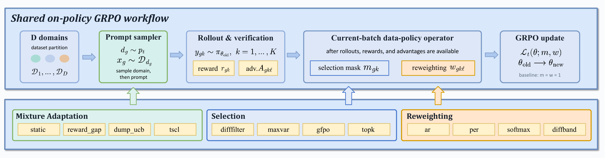

# DataFlex-RL

**Composable data scheduling for RLVR and GRPO.** DataFlex-RL is a zero-fork
plugin for [verl](https://github.com/volcengine/verl) that lets you decide which
rollouts to keep, how strongly to weight them, and which domains to sample next.
It uses signals already produced by the RL loop, so the surrounding rollout,
verification, and policy-update code stays unchanged.

[Documentation](https://haolpku.github.io/DataFlex-RL-Doc) ·
[Evaluation companion](https://github.com/haolpku/DataFlex-RL-Paper) ·
[Design notes](docs/DESIGN.md) ·
[Quickstart](docs/QUICKSTART.md)



*DataFlex-RL inserts configurable selection, reweighting, and mixture controls into
the shared verl/GRPO workflow.*

## Why DataFlex-RL?

RL training already exposes useful signals—rewards, advantages, token
log-probabilities, and prompt groups—but most data-policy ideas are implemented
as one-off changes to a trainer. DataFlex-RL turns those signals into reusable
components:

- **Select** rollouts that carry a useful learning signal.
- **Reweight** samples or tokens without writing a custom policy loss.
- **Mix** domains with an adaptive curriculum for future batches.
- Compare alternatives under the same verl training recipe and inspect the
  resulting per-step metrics.

The code is intentionally small: a scorer produces a signal, and a mechanism
turns that signal into an action. A new combination is normally a configuration,
not a fork of verl.

## Install

```bash
pip install verl          # install the host RL framework first
pip install dataflex_verl # then install the plugin
```

For development:

```bash
git clone https://github.com/haolpku/DataFlex-RL.git
cd DataFlex-RL
pip install -e ".[dev]"
```

## Quick start

Add a small `dataflex` block to a normal `verl` GRPO command:

```bash
python -m verl.trainer.main_ppo \
    trainer.v1.trainer_mode=dataflex_sync \
    +dataflex.mechanism=select \
    +dataflex.scorer.name=group_solve_rate \
    +dataflex.scorer.params.success_threshold=0.5 \
    +dataflex.actuator.name=threshold_band \
    +dataflex.actuator.params.low=0.2 \
    +dataflex.actuator.params.high=0.8 \
    +dataflex.warmup_step=0 \
    ... # your usual verl arguments
```

DataFlex-RL registers its trainers through verl's plugin entry point and reuses
verl's existing policy-loss hook. You keep the standard `main_ppo` entry point;
the plugin only adds the data-policy configuration and its metrics.

## Three mechanisms

| Mechanism | What changes | Where it acts | Typical use |
|---|---|---|---|
| `select` | Which rollouts contribute to the update | After advantage computation | Difficulty filtering, top-k, max-variance |
| `reweight` | How much each sample or token contributes | In the policy loss | Advantage or token-probability weighting |
| `mix` | Which domain supplies the next batch | Before the next rollout | Reward-gap, DUMP-UCB, or TSCL curricula |

### Signal + mechanism

The same signal can be paired with different actions. For example, a reward
signal can filter extreme groups, up-weight a middle difficulty band, or guide a
domain mixer. The built-in scorers include:

`group_solve_rate` · `reward_difficulty` · `advantage_magnitude` ·
`token_prob`

The built-in actuators include:

`threshold_band` · `topk_fraction` · `max_variance` · `matched_random` ·
`softmax` · `per_advantage` · `advantage_reweight` · `reward_gap` ·
`dump_ucb` · `tscl`

Example configurations:

```yaml
# Select mid-difficulty groups
mechanism: select
scorer: {name: group_solve_rate, params: {success_threshold: 0.5}}
actuator: {name: threshold_band, params: {low: 0.2, high: 0.8}}

# Reweight by advantage magnitude
mechanism: reweight
scorer: {name: advantage_magnitude, params: {agg: mean}}
actuator: {name: softmax, params: {temperature: 1.0}}

# Adapt the domain mixture from learning progress
mechanism: mix
scorer: {name: reward_difficulty}
actuator: {name: reward_gap, params: {temperature: 1.0, floor: 0.05}}
```

## Run the included demos

The examples are short GRPO smoke tests on Qwen2.5-0.5B and GSM8K. They are
intended to verify the integration and expose the DataFlex metrics, not to replace
a full training campaign.

```bash
# Set these for your machine; the scripts also accept DATAFLEX_MODEL and DATAFLEX_DATA.
export DATAFLEX_ROOT=/path/to/dataflex-demo
export DATAFLEX_MODEL=$DATAFLEX_ROOT/models/Qwen2.5-0.5B-Instruct
export DATAFLEX_DATA=$DATAFLEX_ROOT/data/gsm8k

bash examples/run_demo.sh reweight
bash examples/run_demo.sh select

# Mix requires a parquet with a separate `domain` column.
python examples/build_2domain_gsm8k.py \
    --src "$DATAFLEX_DATA" --dst "$DATAFLEX_ROOT/data/gsm8k_2domain"
bash examples/run_demo.sh mix
```

The scripts print metrics such as `dataflex/weight_mean`,
`dataflex/kept_frac`, and `dataflex/prop_<domain>`. See the
[full quickstart](docs/QUICKSTART.md) for data preparation, scaling notes, and
troubleshooting.

## What is included

- A framework-agnostic scorer/actuator core and verl v1 trainers.
- Select, reweight, and mix implementations with registry-based configuration.
- Matched-random and matched-update-token helpers for controlled diagnostics.
- End-to-end examples and CPU-only unit tests.
- Bilingual [documentation](https://haolpku.github.io/DataFlex-RL-Doc) and a
  separate [evaluation companion](https://github.com/haolpku/DataFlex-RL-Paper)
  for the controlled RLVR study.

## Tests

```bash
pip install -e ".[dev]"
pytest   # no GPU needed for the unit tests
```

## Add a new component

Subclass the relevant scorer or actuator, register it, and refer to it by name in
the config. See `src/dataflex_verl/scorers.py` and the
[developer guide](https://haolpku.github.io/DataFlex-RL-Doc/en/guide/basicinfo/algorithms/).

```python
from dataflex_verl.core.registry import register_scorer
from dataflex_verl.core.scorer import Scorer

@register_scorer("my_scorer")
class MyScorer(Scorer):
    requires = ["old_log_probs", "response_mask"]
    timing = "post_advantage"
    granularity = "prompt"

    def score(self, batch, step_id, **ctx):
        # Return one score per prompt.
        ...
```

## Compatibility

DataFlex-RL targets verl's v1 trainer and standard GRPO-style data flow. Install a
verl version compatible with your environment, then run the sanity check in
`docs/QUICKSTART.md` before launching a multi-GPU job. The plugin does not install
verl automatically because the host framework and CUDA stack are deployment-specific.

## License

Apache-2.0. See `pyproject.toml` for package metadata.
